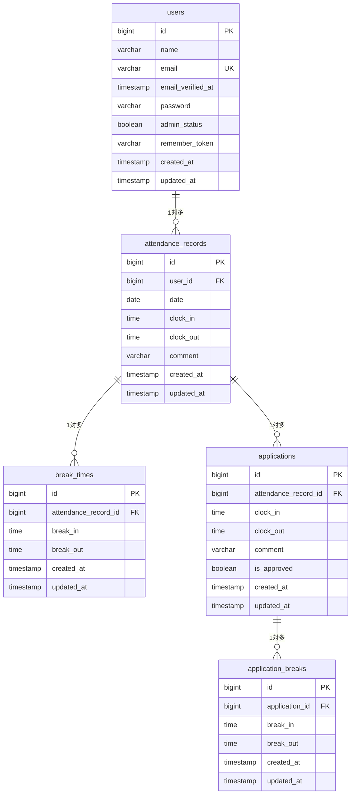

# coachtech 勤怠管理アプリ

## 環境構築

### Dockerビルド

1. リポジトリをクローン
   ```bash
   git clone https://github.com/shiningsword20/attendance-app.git
   cd attendance-app
   ```
2. Composerパッケージをインストール（vendor がないため、Sail起動前に実行）
   ```bash
   docker run --rm \
     -u "$(id -u):$(id -g)" \
     -v "$(pwd):/var/www/html" \
     -w /var/www/html \
     laravelsail/php82-composer:latest \
     composer install --ignore-platform-reqs
   ```
3. `.env` を作成
   ```bash
   cp .env.example .env
   ```
4. `.env` のDB設定を以下に変更
   ```text
   DB_CONNECTION=mysql
   DB_HOST=mysql
   DB_PORT=3306
   DB_DATABASE=laravel
   DB_USERNAME=sail
   DB_PASSWORD=password
   ```
   メール設定は `.env.example` のまま（`MAIL_HOST=mailpit` / `MAIL_PORT=1025`）で動作します。
5. Sailのエイリアスを設定（以降のコマンドは `sail` で実行します）
   ```bash
   alias sail='[ -f sail ] && bash sail || bash vendor/bin/sail'
   ```
6. コンテナをビルド・起動
   ```bash
   sail up -d --build
   ```
   ※ Apple Silicon（M1〜M4）の場合は、`compose.yaml` の mysql に `platform: 'linux/amd64'` を追記してください。

### Laravel環境構築

1. アプリケーションキーを作成
   ```bash
   sail artisan key:generate
   ```
2. マイグレーション・シーディングを実行
   ```bash
   sail artisan migrate --seed
   ```
3. フロントエンド（Vite）を起動
   ```bash
   sail npm install
   sail npm run dev
   ```

## 使用技術（実行環境）

- PHP 8.2
- Laravel 10.x
- Laravel Fortify（認証）
- MySQL 8.4
- Laravel Sail（Docker）
- Vite 5
- phpMyAdmin / Mailpit

## ER図



※ attendance_records は `user_id` と `date` の組み合わせでユニーク（1ユーザー1日1件）です。

## URL

- 開発環境（一般ユーザーログイン）：http://localhost/login
- 会員登録：http://localhost/register
- 管理者ログイン：http://localhost/admin/login
- phpMyAdmin：http://localhost:8080
- Mailpit：http://localhost:8025

## ログイン情報

シーディング（`sail artisan migrate --seed`）で以下のユーザーが作成されます。いずれもメール認証済みです。

| 権限 | 名前 | メールアドレス | パスワード | ログインURL |
| --- | --- | --- | --- | --- |
| 一般ユーザー | ユーザー1 | user1@example.com | password | http://localhost/login |
| 一般ユーザー | ユーザー2 | user2@example.com | password | http://localhost/login |
| 管理者 | ユーザー3 | user3@example.com | password | http://localhost/admin/login |

### ダミーデータ（勤怠・休憩）

- user1：過去5か月は各月平日15日の通常勤務（9:00〜18:00）、当月は17日分（通常10・残業3・遅刻2・早退1・長時間労働1）。全レコードに休憩12:00〜13:00を登録。打刻を確認できるよう、当日分は作成していません。
- user2・user3：2か月前の1日から前日までの平日に通常勤務（9:00〜18:00、休憩12:00〜13:00）

## テスト

PHPUnitによるFeatureテスト（テストケース一覧 ID1〜15）を用意しています。テストは `testing` データベースを使用します（Sailのmysqlコンテナ初回起動時に自動作成されます）。

```bash
sail artisan test
```
