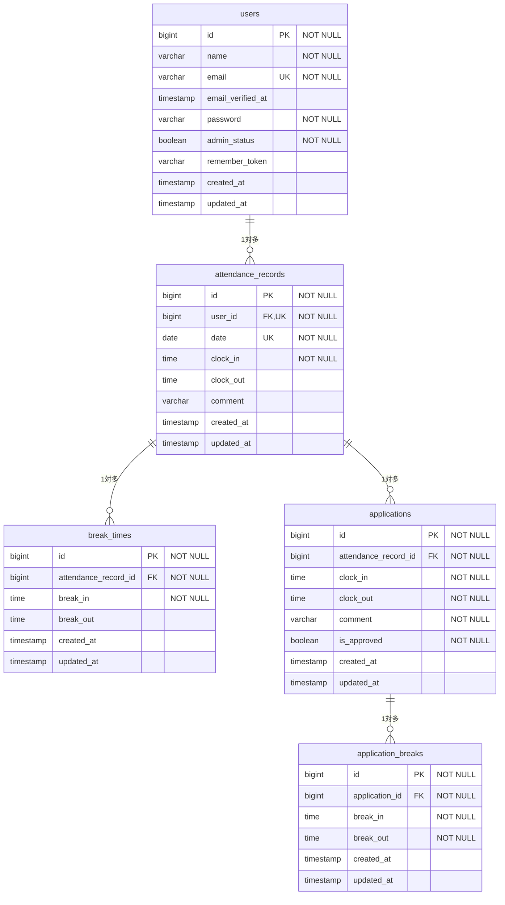

# coachtech 勤怠管理アプリ

## 環境構築

### Dockerビルド

1. リポジトリをクローン
   ```bash
   git clone https://github.com/shiningsword20/attendance-app.git
   cd attendance-app
   ```
2. Composerパッケージをインストール（vendor がないため、Sail起動前に実行）
   ```bash
   docker run --rm \
     -u "$(id -u):$(id -g)" \
     -v "$(pwd):/var/www/html" \
     -w /var/www/html \
     laravelsail/php82-composer:latest \
     composer install --ignore-platform-reqs
   ```
3. `.env` を作成
   ```bash
   cp .env.example .env
   ```
4. `.env` のDB設定を以下に変更
   ```text
   DB_CONNECTION=mysql
   DB_HOST=mysql
   DB_PORT=3306
   DB_DATABASE=laravel
   DB_USERNAME=sail
   DB_PASSWORD=password
   ```
   メール設定は `.env.example` のまま（`MAIL_MAILER=smtp` / `MAIL_HOST=mailpit` / `MAIL_PORT=1025`）で動作します。
5. Sailのエイリアスを設定（以降のコマンドは `sail` で実行します）
   ```bash
   alias sail='[ -f sail ] && bash sail || bash vendor/bin/sail'
   ```
6. コンテナをビルド・起動
   ```bash
   sail up -d --build
   ```
   ※ Apple Silicon（M1〜M4）の場合は、`compose.yaml` の mysql に `platform: 'linux/amd64'` を追記してください。

### Laravel環境構築

1. アプリケーションキーを作成
   ```bash
   sail artisan key:generate
   ```
2. マイグレーション・シーディングを実行
   ```bash
   sail artisan migrate --seed
   ```
3. フロントエンド（Vite）を起動
   ```bash
   sail npm install
   sail npm run dev
   ```

## 使用技術（実行環境）

- PHP 8.2
- Laravel 10.x
- Laravel Fortify（認証・メール認証）
- Laravel Sanctum（公開APIのトークン認証）
- MySQL 8.4
- Laravel Sail（Docker）
- Vite 5
- PHPUnit 10
- phpMyAdmin / Mailpit

## ER図



※ attendance_records は `user_id` と `date` の組み合わせでユニーク（1ユーザー1日1件）です。

## URL

- 開発環境（一般ユーザーログイン）：http://localhost/login
- 会員登録：http://localhost/register
- 管理者ログイン：http://localhost/admin/login
- マイ勤怠レポート（一般ユーザー）：http://localhost/attendance/report
- 公開API：http://localhost/api/v1/attendance-records
- phpMyAdmin：http://localhost:8080
- Mailpit：http://localhost:8025

## ログイン情報

シーディング（`sail artisan migrate --seed`）で以下のユーザーが作成されます。いずれもメール認証済みです。

| 権限 | 名前 | メールアドレス | パスワード | ログインURL |
| --- | --- | --- | --- | --- |
| 一般ユーザー | ユーザー1 | user1@example.com | password | http://localhost/login |
| 一般ユーザー | ユーザー2 | user2@example.com | password | http://localhost/login |
| 管理者 | ユーザー3 | user3@example.com | password | http://localhost/admin/login |

### ダミーデータ（勤怠・休憩）

- user1
  - 過去5か月：各月の平日15日に通常勤務（9:00〜18:00）
  - 当月：平日の先頭から17日分（通常10・残業3・遅刻2・早退1・長時間労働1）。打刻を確認できるよう、当日分は作成していません。シーディングした日によっては、当日より後の日付にも勤怠が作成されます。
  - 全レコードに休憩 12:00〜13:00 を登録
- user2・user3：2か月前の1日から前日までの平日に通常勤務（9:00〜18:00、休憩 12:00〜13:00）

user1 でマイ勤怠レポートを開くと、過去6か月の総労働時間 744時間、総残業時間 10時間、1日の平均労働時間 8時間5分、当月の遅刻 2回・早退 1回・長時間労働 1日が表示されます。

## 応用機能

### メール認証

会員登録後、認証メールが送信されます。Mailpit（http://localhost:8025）でメールを開き、認証リンクを押すと打刻画面に移動します。認証誘導画面から認証メールの再送もできます。

### CSV出力（管理者）

スタッフ別勤怠一覧画面の「CSV出力」ボタンで、表示中の月の勤怠をCSVでダウンロードできます。

### マイ勤怠レポート（一般ユーザー）

ヘッダーの「レポート」から、過去6か月の労働時間・残業時間の集計と、当月の遅刻・早退・長時間労働の回数を確認できます。

### 公開API

| メソッド | パス | 認証 | 内容 |
| --- | --- | --- | --- |
| GET | /api/v1/attendance-records | 不要 | 勤怠一覧（`user_id` `date` `month` `page` `per_page` で絞り込み・ページング） |
| GET | /api/v1/attendance-records/{id} | 不要 | 勤怠詳細 |
| POST | /api/v1/attendance-records | 必要 | 勤怠登録 |
| PUT / PATCH | /api/v1/attendance-records/{id} | 必要 | 勤怠更新 |
| DELETE | /api/v1/attendance-records/{id} | 必要 | 勤怠削除 |

認証が必要なAPIは、Sanctum のトークンを `Authorization: Bearer {トークン}` ヘッダで送ります。トークンは tinker で発行します。

```bash
sail artisan tinker
>>> App\Models\User::where('email', 'user1@example.com')->first()->createToken('api')->plainTextToken;
```

リクエスト例

```bash
curl "http://localhost/api/v1/attendance-records?per_page=5"

curl -X POST http://localhost/api/v1/attendance-records \
  -H "Authorization: Bearer {トークン}" \
  -H "Accept: application/json" \
  -H "Content-Type: application/json" \
  -d '{"date":"2026-12-01","clock_in":"09:00:00","clock_out":"18:00:00","comment":"API登録"}'
```

## テスト

PHPUnitによるFeatureテスト（テストケース一覧 ID1〜20）を用意しています。テストは `testing` データベースを使用します（Sailのmysqlコンテナ初回起動時に自動作成されます）。

```bash
sail artisan test
```
